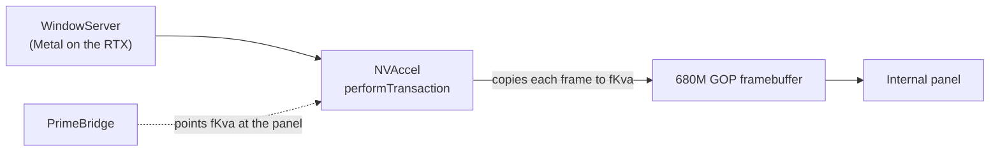

<div align="center">

# PrimeBridge

**NVIDIA-accelerated macOS on the internal screen of AMD laptops without a MUX switch**


</div>

On many AMD + NVIDIA laptops the internal screen is wired only to the AMD iGPU, and macOS has no driver for it. PrimeBridge lets macOS render on the NVIDIA GPU through the [NullMoth](https://nullmothsystems.com) Metal driver and shows the result on the internal screen. It reuses the framebuffer that the firmware (GOP) left on the iGPU and makes NullMoth's frames land in it.

> [!IMPORTANT]
> **Testers wanted.** PrimeBridge works on one laptop today. I want it to work on every MUX-less AMD + NVIDIA laptop, and I can only get there with reports from other machines. If you have one, try it and send a [test report](#feedback), even if it fails. Reports from other Radeon iGPUs (780M, 760M, Vega) help too: they show which offsets need to change. You can also reach me on Discord: **@64417**.



## Status

This fork runs on, and is tuned for, one machine:

| | |
|---|---|
| Laptop | HP Victus 15 (AMD) |
| CPU | Ryzen 7 7445HS |
| iGPU | Radeon 740M (`1002:1901`, HawkPoint2, GC 11.0.4 / DCN 3.1.4) |
| dGPU | GeForce RTX 4050 Laptop (`10de:28a1`) |
| Panel | 1920x1080, 144 Hz |
| Software | macOS 26.7.2, NullMoth 3.0 |

On it, the internal panel runs at **144 Hz** with **direct scanout** (`PrimeMode = direct-kva`: NVAccel writes the panel buffer itself, 0 µs copy work) and working **brightness** (slider and keys, through the iGPU's DCN PWM backlight).

Upstream 0.4.8 still runs on the Acer Nitro V 15 (Ryzen 5 7535HS, Radeon 680M `1002:1681`, RTX 4050 Laptop, 1920x1080 144 Hz, NullMoth 2.6.3).

> [!WARNING]
> PrimeBridge is a kernel extension. It writes to the iGPU's memory and changes a private pointer inside NullMoth's NVRMFB kext. It comes with no warranty. Keep an HDMI monitor at hand for your first boots, and try it from a USB stick before touching your internal install.

## Requirements

- An AMD APU with a Radeon 680M (`1002:1681`, Rembrandt: GC 10.3.3 / DCN 3.1.2) or a Phoenix/Hawk Point 740M/760M/780M (`1002:15BF`, `15C8`, `1900`, `1901`: GC 11.0.x / DCN 3.1.x). The layout is picked from the PCI device ID (`kLayoutRembrandt`, `kLayoutPhoenix`, `kLayoutHawkPoint`), and the boot-args below can override it during bring-up.
- **NullMoth 3.0** (2.9 also works) with this project's patched NVRMFB. The `nvfbforce` patch is kept in step with the installed driver version — `NVRMFB-patch/nvfbforce-2.9.patch` applies to 2.9 and 3.0, `NVRMFB-patch/nvfbforce.patch` is the 2.7.x one. See [Building the patched NVRMFB](#building-the-patched-nvrmfb-for-your-nullmoth-version).
- At least one HDMI connector wired to the NVIDIA GPU, with nothing plugged into it.
- macOS already booting normally (USB ports mapped and so on). PrimeBridge does not fix boot problems.
- A 32 bpp firmware boot framebuffer inside the iGPU's BAR0. PrimeBridge checks this and refuses otherwise.

## Building the patched NVRMFB for your NullMoth version

The 1401 app installs the **stock** NVRMFB, which has no fake display, so after every NullMoth
update you must rebuild the patched one for that exact version. (PrimeBridge itself lives in the EFI
and is untouched by driver updates.)

1. Get NullMoth's source at the installed tag: `git clone --depth 1 -b v3.0 https://github.com/nullmoth/nvidia-macos-driver`.
2. Build against the matching NVIDIA `open-gpu-kernel-modules` tree — **620.70.06 for 2.9/3.0** —
   with NullMoth's own patch chain applied first (`kexts/NVRM/patches/*.patch`, file-name order,
   `patch -p1 --fuzz=0`, trying `src/nvidia-modeset`, `.`, `src/nvidia`). Without it the headers
   lack `colorBpc`/`colorRange`/`vrrEnabledChanged` and NVRMFB does not compile.
3. Apply this project's patch from `NVRMFB-patch/`.
4. Build with NullMoth's own builder: `OGKM=<620.70.06 tree> bash build/fb_build.sh kexts <out>`.
5. Stamp `CFBundleShortVersionString` to the driver version, ad-hoc sign, copy to
   `/Library/Extensions/NVRMFB.kext`, rebuild the auxiliary kernel collection, reboot.

### Brightness

NullMoth's backlight handler normally dims the NVIDIA panel; here the panel is on the iGPU. The
patch hands that handler to **PrimeBridge** when NVKMS reports no backlight for the forced head, and
the fake head is reported **built-in** so macOS creates an `AppleBacklightDisplay`. PrimeBridge then
writes the iGPU's DCN PWM backlight: `PWRSEQ0_BL_PWM_CNTL` (DCN segment 2, `0x2f19`), duty =
`percent × 65535 / 100`, preserving the enable bits. `primebright=N` (0..100) is a raw test knob that
performs the same write once at probe time.

### The NVIDIA field PrimeBridge points at

It no longer hard-codes `fKva`'s offset inside `NVRMNVDAFramebuffer`: NullMoth moved it in 2.9
(`+0x360` in 2.9/3.0, `+0x2d8` in 2.6.x/2.7.x), so PrimeBridge scans the object for the adjacent
`{kva, phys}` pair and uses whatever it finds. `ioreg -rc PrimeBridge` reports it as `NVFBKvaOffset`.

## Installation

Download `PrimeBridge-0.4.9.zip` from the [Releases](../../releases) page. It contains:

| File | md5 of the binary |
|---|---|
| `PrimeBridge.kext` | `6dd9364d0a3946162ad2f01d5ab932eb` |
| `NVRMFB.kext` (NullMoth 2.6.3 + `nvfbforce`; a 2.6.6 build has its own md5) | `6a3402872b7b14a5485aeda97afc7df2` |
| `install-nvrmfb.sh` | |

> [!IMPORTANT]
> Match `NVRMFB.kext` to your NullMoth version. The released kext is patched for NullMoth 2.6.3. If you run 2.6.6, apply `NVRMFB-patch/nvfbforce.patch` to the 2.6.6 `kexts/NVRMFB/fb/nvrm-fb.cpp` (byte-identical to 2.6.3) and build it, instead of installing the 2.6.3 kext over your 2.6.6 one.

1. Get macOS booting with NullMoth (2.6.3 or 2.6.6) on an external monitor first.
2. Install the patched NVRMFB from the unzipped folder:
   ```bash
   sudo sh install-nvrmfb.sh
   ```
   Approve the update in System Settings > Privacy & Security if macOS asks, then reboot.
3. Copy `PrimeBridge.kext` to `EFI/OC/Kexts/` and add it to `Kernel > Add` in `config.plist` (BundlePath `PrimeBridge.kext`, ExecutablePath `Contents/MacOS/PrimeBridge`, PlistPath `Contents/Info.plist`, Enabled true; no MinKernel or MaxKernel needed).
4. In `Kernel > Patch`, disable `Algrey / Zormeister | _mtrr_update_action | Fix PAT | 15.0+` and leave the Shaneee variants disabled. [Why](#why-fix-pat-must-be-off).
5. Add these boot-args next to your own:
   ```
   debug=0x100 keepsyms=1 nvfb=1 nvaccel=1 nvfbheads=4 -nvkmsnosmooth -nvrmnoflip nvfbforce=1 nvcursor=0
   ```
   `nvfb=1 nvaccel=1` belong to NullMoth (see its docs for the others). `nvfbforce=1` creates the fake HDMI monitor. `nvcursor=0` turns off the NVIDIA hardware cursor, so macOS draws the cursor into the frame and it shows on the panel.
6. Unplug any monitor from the NVIDIA GPU and reboot. NullMoth publishes the framebuffer about 30 s after boot; the rest is immediate. Leave a still desktop on screen for a few seconds so the iGPU probe and the direct-mode switch can run.

### Rollback

- Black internal screen: plug an HDMI monitor into the NVIDIA GPU (the fake connector exists only when nothing is plugged in), or add `-primeoff` to the boot-args to stop PrimeBridge.
- Original NVRMFB: `sudo sh install-nvrmfb.sh NVRMFB-orig.kext`, then reboot.

## Checking that it works

PrimeBridge logs to `/var/log/PrimeBridge.log`.

```bash
tail -40 /var/log/PrimeBridge.log
ioreg -rc PrimeBridge -d1 | grep -E "Version|PrimeMode"
```

A healthy start:

```
PrimeBridge 0.4.9 starting (log=1)
FB 1920x1080 bpp 32 stride 7680 B ... phys 0x490000000 ... BAR0 0x490000000 +0x10000000
found NVRMNVDAFramebuffer 1920x1080 pitch 7680 phys 0x...
redirected NVRMNVDAFramebuffer scanout kva to cached staging (8294400 bytes)
igpu probe: FB_OFFSET 0x00000440 FB_LOCATION 0x0000f400..0x0000f41f -> VRAM at phys 0x440000000, 512 MB; GOP at VRAM +0x0
igpu probe: phys 0x440000000, 61440 px: 0 differ from what we wrote (61434 lit), ... -> MATCH
igpu writes: PAT 0x... (PA6 WC)
igpu writes: ns per row: BAR0 2004, BAR0 write-combined 2343, VRAM write-combined 1355 -> VRAM at phys, fast
NVAccel now writes its frames straight into the panel's buffer (no staging copy, no diff)
rate-hint: 144 Hz, work avg 0 us max 0 us, ... panel 143.78 Hz, direct
```

When something is off:

- `inconclusive (screen too dark)`: the probe tries again on a later still screen. Leave something bright on screen.
- `PA6 not WC` with writes around 40 µs per row: the Fix PAT patch is still active.
- No `found NVRMNVDAFramebuffer` line: NVRMFB did not create head 0. Check `nvfbforce=1`, that nothing is plugged into the NVIDIA GPU, and that the NVIDIA GPU has an HDMI connector.
- NullMoth's counters can help: `sysctl debug.nvaccel_iop_ok debug.nvaccel_surface_gpu_timeouts debug.nvaccel_iop_copy_skip`.

## Feedback

The goal is a driver that works on any MUX-less AMD + NVIDIA laptop. Open an issue with the [Test report](../../issues/new?template=test-report.yml) template, or reach me on Discord: **@64417**.

The template asks for the laptop model, PCI IDs, panel resolution, macOS and NullMoth versions, the Fix PAT setting, the `ioreg` output and the end of the log. With those, most problems can be narrowed down without a back-and-forth.

## How it works

### The problem

The internal panel is physically connected to the iGPU, which macOS cannot drive. NullMoth drives the NVIDIA GPU, but its accelerator (NVAccel) runs only when an NVIDIA display head exists, and that normally needs a monitor on the NVIDIA card. Meanwhile the firmware's GOP has already lit the panel and left the iGPU scanning out a plain framebuffer in its own memory (1920x1080, 32 bpp, BGRX on the test machine). Anything written there appears on the panel.

### The data path

1. **NVRMFB with `nvfbforce=1`.** When nothing is plugged in, the first HDMI connector of the NVIDIA GPU reports itself connected, with a built-in EDID named "PrimeBridge" (this fork: 1920x1080 at 144 Hz, 320 MHz, with 120/60 Hz fallbacks). Head 0 exists, WindowServer composites on the RTX with Metal, and NVAccel runs. This trick works on HDMI only: DisplayPort needs a real sink to train the link.
2. **NVAccel's present.** Every frame, WindowServer's swap goes through `NVDisplayPipe::performTransaction` in NullMoth's `nvrm-accel.cpp`. With zero-copy flips off (`debug.nvaccel_iop_flip=0`, which PrimeBridge enforces), NVAccel copies the composited IOSurface with the CPU to the framebuffer address it gets from NVRMFB (`fKva`).
3. **PrimeBridge redirects `fKva`.** It finds `NVRMNVDAFramebuffer`, checks its private fields against the public `nvScanoutInfo` call, then overwrites `fKva` (its offset is found by scanning the object for the adjacent `{kva, phys}` pair, so a NullMoth update that moves it still works).
4. **Staging mode.** At first `fKva` points to a cached RAM buffer. A timer at the `primehz` rate (default 60; 144 recommended here) compares it row by row with a shadow copy and writes the changed rows to the GOP framebuffer.
5. **Probe and direct mode.** As soon as the screen has been still, PrimeBridge maps the iGPU's register BAR (BAR5) and reads `GCMC_VM_FB_OFFSET` to find where the iGPU's VRAM sits in system RAM (`0x440000000`, 512 MB on the test machine), as Linux amdgpu does on x86 APUs. It compares 32 rows read there with what it wrote and logs `MATCH`. Then it times rewriting 64 identical rows (invisible on screen) through BAR0 as mapped at boot, BAR0 write-combined, and VRAM write-combined, and keeps the fastest mapping. Only these timed rewrites and the final switch write anything.

   If writes take under 3 µs per row and the NVIDIA mode has exactly the panel's width, height and pitch, PrimeBridge points `fKva` straight at the panel's framebuffer. From then on NVAccel writes each frame directly to the screen, and the staging copy, the row diff and the PrimeBridge timer all drop out. The log says `direct` and `PrimeMode` becomes `direct-kva`.
6. **Geometry check.** Every 64 timer ticks PrimeBridge re-reads the NVIDIA scanout geometry. If it changed (resolution switch, re-allocation), PrimeBridge restores NVRMFB's original pointer, falls back to staging, and goes direct again once the geometry matches.
7. **Panel refresh.** PrimeBridge reads the iGPU's OTG frame counter and logs the panel's real refresh rate on every `rate-hint` line.

PrimeBridge never writes to the VRAM address unless it first read back there exactly what it had written through BAR0.

### Why Fix PAT must be off

macOS maps write-combined (WC) memory through PAT entry PA6. AMD Vanilla's `_mtrr_update_action | Fix PAT` patches (Algrey's is on by default) replace macOS's PAT with `0x0007010600070106`, where PA6 is UC- (uncached). Every WC mapping in macOS then becomes uncached, PrimeBridge's writes and CPU access to NVIDIA VRAM included.

Measured on the test machine, per 7680-byte row:

| | Fix PAT on | Fix PAT off |
|---|---|---|
| BAR0 | 39.7 µs | 2.0 µs |
| iGPU VRAM, write-combined | 75.4 µs | 1.4 µs (about 5.7 GB/s) |
| Result | staging mode, `kernel_task` at 75 % in video | direct mode, `kernel_task` at 2.5 % |

AMD Vanilla's own README says the patch does not improve performance and that some systems run better without it. Test without it on a USB stick first.

## Adapting it to another laptop

### Panel resolution

Direct mode needs the NVIDIA mode to equal the GOP framebuffer: same width, height and pitch (width x 4). The GOP usually runs the panel at its native resolution, which the `FB ...` log line shows. If it is not 1920x1080, PrimeBridge stays in staging mode and copies only the top-left 1920x1080 (cropped and slower).

The fix is a forced EDID with the panel's resolution in `kForcedEdid[128]` in `nvrm-fb.cpp` (see `nvfbforce.patch`), then a rebuild of NVRMFB from the NullMoth 2.6.3 or 2.6.6 sources (identical files).

- The mode lives in the first detailed timing descriptor, bytes 54 to 71. Byte 127 is the checksum: all 128 bytes must sum to 0 mod 256. The range-limits descriptor (`00 00 00 fd`) must allow the new refresh rate and pixel clock.
- Generate the EDID with a tool (an EDID editor, or `cvt -r` / `cvt` timings typed into one) and check it with `edid-decode`. Do not hand-edit it without recomputing the checksum.
- Without an HDMI vendor block NVKMS caps the pixel clock at about 165 MHz, which 1920x1080@144 does not fit. The fix this fork uses: a **256-byte EDID with a CTA-861 extension** carrying the HDMI LLC and HDMI Forum VSDBs (which lift the cap to 340 MHz), plus a reduced-blanking timing — 1920x1080@144 at **320 MHz** (2000x1111). A 120 Hz and a 60 Hz DTD are included as fallbacks.
- After the change, the log should show `found NVRMNVDAFramebuffer <W>x<H> pitch <W*4>` matching the `FB` line.

### A different iGPU

`selectRegisterLayout()` picks a register table from the PCI device ID: `kLayoutRembrandt` for the 680M (`1002:1681`, GC 10.3.3 / DCN 3.1.2) and `kLayoutPhoenix` for the Phoenix/Hawk Point family (`15BF`, `15C8`, `1900`, `1901`, GC 11.0.x / DCN 3.1.x). The tables live in `PrimeBridge.cpp` and come from Linux amdgpu: `yellow_carp_offset.h` / `gc_10_3_0_offset.h` / `dcn_3_1_2_offset.h` for Rembrandt, and `gc_11_0_0_offset.h` / `dcn_3_1_4_offset.h` for Phoenix. GC 11.0.4 (HawkPoint2) uses `gfxhub_v3_0`, which reads `GCMC_VM_FB_OFFSET << 24` the same way as the 680M.

The GC and DCN segment bases (`0x1260` and `0x34C0`) come from the APU's IP discovery table, not from a public header. They are correct for the machines tested so far and are the values this project already used. If a probe reports implausible offsets, override them from the boot-args below and check the `MATCH` line in the log.

### Another NullMoth version

`attachNvidiaScanout()` no longer relies on fixed offsets: it scans the `NVRMNVDAFramebuffer` object for the adjacent `{kva, phys}` pair, so the 2.9/3.0 move (`0x2d8` → `0x360`) needed no change. If no pair is found, `NVFBOffsetsVerified` in `ioreg` turns false and PrimeBridge leaves NVRMFB alone. The `nvfbforce` patch still has to be re-applied to each new `nvrm-fb.cpp` (see [Building the patched NVRMFB](#building-the-patched-nvrmfb-for-your-nullmoth-version)).

## Boot-args

| Boot-arg | Effect |
|---|---|
| `-primeoff` | PrimeBridge does not load (escape hatch) |
| `-primelogoff` | No log file |
| `primecarve=0` | Skip the VRAM probe and write benchmark (stays on BAR0, no direct mode) |
| `primehz=N` | Staging timer rate (default 60, 24 to 240) |
| `primefmt=N` | Pixel packing in staging mode: 1 = BGRX (default), 2 = RGBX, 3 = raw. Direct mode runs only with 1 |
| `primetest=1/2/3`, `primecolors=1` | Test patterns on the panel during boot, for checking colors and stride |
| `primegcb=0xNNN` | Override the GC segment 0 base (dwords, default `0x1260`) |
| `primedcnb=0xNNN` | Override the DCN/DMU segment 2 base (dwords, default `0x34C0`) |
| `primefbofs=0xNNN` | Override the `GCMC_VM_FB_OFFSET` register offset (dwords) |
| `primefbbase=0xNNN`, `primefbtop=0xNNN` | Override the `GCMC_VM_FB_LOCATION_BASE/TOP` register offsets (dwords) |
| `primeotgctl=0xNNN`, `primeotgh=0xNNN`, `primeotgv=0xNNN`, `primeotgf=0xNNN`, `primeotgs=0xNNN` | Override the OTG0 control/h_total/v_total/frame-count register offsets and the OTG instance stride (dwords) |

All register overrides are unsigned hex values in Linux amdgpu's dword units, e.g. `primegcb=0x1260`. Values are accepted in decimal, `0x` hex, `0b` binary or octal, like every other macOS boot-arg. A layout whose computed byte offsets fall outside `kBar5MapLen` (0x80000) is rejected and the probe is skipped; the redirect itself does not depend on these registers.

## Building

On a Mac with the Command Line Tools (Xcode is not needed):

```bash
cd PrimeBridge-source
sh build.sh
```

`build.sh` expects `MacOSX15.4.sdk` from the Command Line Tools; set `SDK=` to use another one. The output is `build/PrimeBridge.kext`, ad-hoc signed. Kernel code must not use floating point, so this has to print 0:

```bash
otool -tV build/PrimeBridge.kext/Contents/MacOS/PrimeBridge | grep -cE "cvtsi2sd|divsd"
```

### Where to start in the code

- `PrimeBridge.cpp`: `attachNvidiaScanout()` does the redirect, `probeIgpu()` and `chooseWriteMapping()` probe the iGPU and benchmark the writes, and `tickNullMoth()` runs the staging copy, the geometry check and the switch to direct mode.
- `BootFramebuffer.cpp` maps the GOP framebuffer (`attach()`, `mapWriteCombined()`).
- `NVRMFB-patch/nvfbforce.patch` is the NVIDIA side. The frame copy into `fKva` is `NVDisplayPipe::performTransaction` in NullMoth's `kexts/NVRM/accel/nvrm-accel.cpp`.

Diagnose from `/var/log/PrimeBridge.log` and `ioreg -rc PrimeBridge` before changing code. [`llms.txt`](llms.txt) holds the full original technical notes, for people and AI assistants working on the code.

## Known limits

- The NVIDIA mode comes from the forced EDID. This fork's EDID is 1920x1080@144 with a 120 Hz and 60 Hz fallback, matching this panel; a different panel resolution needs its own EDID (see Panel resolution).
- NVAccel waits up to 100 ms for a composite to finish before copying (`kSurfGpuWaitMs` in `nvrm-accel.cpp`). The test machine still hits a few of these per 10 minutes (`debug.nvaccel_surface_gpu_timeouts`), seen as short freezes.
- Tearing is possible, because the iGPU scans out the same buffer NVAccel writes into (no double buffering).
- Sleep and wake are untested.
- A smaller mode picked in System Settings shows top-left without scaling. A mode larger than the first one can overflow until the geometry check catches it, about a second later.
- The RTX stays powered all the time since it renders the desktop, so battery life is limited.

## Repository contents

| Path | What it is |
|---|---|
| `PrimeBridge-source/` | Driver sources and `build.sh` |
| `NVRMFB-patch/nvfbforce.patch` | The change to NullMoth's `kexts/NVRMFB/fb/nvrm-fb.cpp` (tag v2.6.3, identical in v2.6.6) |
| `NVRMFB-patch/NullMoth-LICENSE`, `NullMoth-NOTICE` | NullMoth's license and notice |
| `install-nvrmfb.sh` | Installs the patched `NVRMFB.kext`, keeps your original, rebuilds the auxiliary kernel collection |
| `llms.txt` | Full technical notes in one file |

## License

PrimeBridge (`PrimeBridge-source/`, `install-nvrmfb.sh` and the docs) is under the [MIT License](LICENSE). You can use, modify and redistribute it for free. Any copy or derived work has to keep the copyright notice, which carries the link to this repository.

`NVRMFB-patch/` and the patched `NVRMFB.kext` are derived from NullMoth 2.6.x and stay under the [PolyForm Noncommercial License 1.0.0](NVRMFB-patch/NullMoth-LICENSE): noncommercial use only. Copyright (c) 2026 NullMoth Systems ([nullmothsystems.com](https://nullmothsystems.com)). This project is not affiliated with NullMoth Systems.
